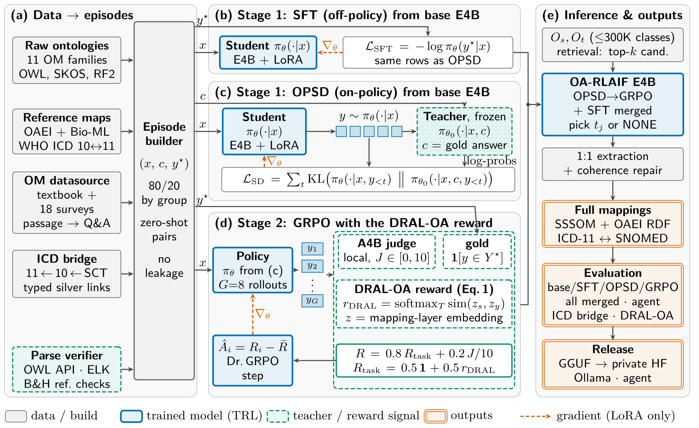

# OA-RLAIF

**Gemma 4 E4B for ontology alignment. Knowledge goes into the weights by on-policy self-distillation, then the model is sharpened with GRPO using the DRAL-OA reward and an A4B judge.** It produces full, domain-agnostic alignments (SSSOM + OAEI RDF), including ICD-11↔SNOMED CT links composed through the WHO ICD-10 bridge.



## What is in here
| Path | What |
|---|---|
| `CLAUDE.md`, `MEMORY.md` | goal, hard rules, dated decision log |
| `docs/PLAN.md` | full plan |
| `docs/LITERATURE_REVIEW.md`, `docs/references.bib` | 93 DOI-verified works (RLHF/RLAIF, OPD, OM, verification) |
| `docs/PLAN_REVIEW.md` | review of the original 16-step plan |
| `docs/REWARD_SPEC.md` | DRAL-OA Eq. 1 → GRPO reward |
| `docs/COVERAGE.md`, `docs/DATA_CARD.md`, `docs/PARSE_VERIFICATION.md` | every raw file's role, derived records, verification |
| `src/oa_rlaif/` | parser, data build, rewards, harness (`om` tool), trainers, evaluation, export |
| `third_party/mini-swe-agent` | vendored agent harness (v2.4.6, MIT) |
| `tools/owl_verify` | OWL API + ELK cross-parser (Java) |
| `LAMBDA_RUNBOOK.md` | how to run on Lambda 4×B200 within $500 (`scripts/lambda_all.sh`) |
| `COREWEAVE_RUNBOOK.md` | how to run on CoreWeave: Docker install, price, any GPU count (`scripts/coreweave_all.sh`) |

## Pipeline
1. **Mac (free).** The verify gate below runs the parse verifier and the leakage/coverage checks; `--hf` pushes the datasets only after your OK.
   ```bash
   scripts/10_prepare_data.sh        # build data
   scripts/15_datasource.sh          # A4B questions
   scripts/20_fit_dral.sh            # DRAL mapping layers
   scripts/80_verify_and_push.sh     # verify gate (+ --hf)
   ```
2. **Lambda or CoreWeave.** One command runs everything: `scripts/lambda_all.sh` or `scripts/coreweave_all.sh` (see the runbooks). The steps below are what it runs. Setup is the only step with downloads. Everything else runs locally. The A4B judge is served on the instance; the only remote model call is A4B question generation on the Mac.
   ```bash
   scripts/lambda_setup.sh
   scripts/00_check_env.sh
   scripts/35_dry_run.sh
   scripts/30_baseline.sh
   scripts/40_sdft.sh
   scripts/50_eval.sh sdft
   scripts/60_grpo.sh
   scripts/50_eval.sh grpo --full
   scripts/70_export.sh
   ```
3. **Anywhere.** `scripts/status.sh` prints the pipeline progress bar, the ETA and spend against the $500 cap.

## Data and licensing
- **Every file is accounted for.** All 2,573 files in the supplied raw folder, plus the Bio-ML 2026 download, have a role (`configs/coverage.yaml`). `verify.py` fails if any is unassigned, or if a data-bearing file yields nothing.
- **Licensed content never enters git.** This covers the OM datasource (Springer © 2007), SNOMED CT (affiliate licence) and UMLS-derived references. Built datasets go only to private Hugging Face repositories.

## Results
None yet. Training has not run. Evaluation tables are filled from `outputs/eval/*/metrics.json` after the Lambda run. The baseline to beat on Anatomy is DRAL-OA's official OAEI 2025 result, F = 0.828.

## Cite the reward source
- Zaeifi, Mosallanezhad, Bansal. *Deeper and Deeper: A Lightweight Semi-Supervised Deep Reinforcement Adaptive Learning-Based Ontology Alignment.* AIxDKE 2024. doi:10.1109/AIxDKE63520.2024.00012
- Gonibeed Ravishankar, Zaefi, Bansal. *DRAL-OA: Results for OAEI 2025.* OM@ISWC 2025, CEUR Vol-4144.
