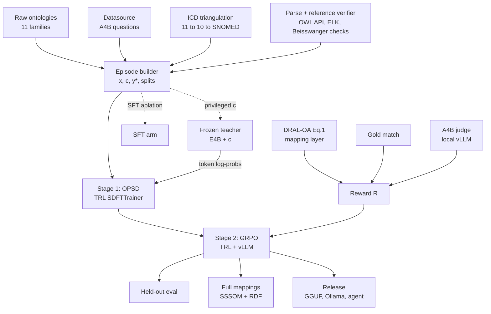

# Plan: `RLAIF/` → private repo **AGR19/OA-RLAIF**. Gemma 4 E4B: on-policy self-distillation (knowledge + skill), then GRPO (DRAL-OA reward + A4B judge), producing full, domain-agnostic ontology alignments, including ICD-11↔SNOMED by triangulation

## ★ STEP 0 (first action after approval): save the plan
- `RLAIF/CLAUDE.md`: the measurable goal (see "Goal in CLAUDE.md" below), the hard rules (no licensed data in git, $500 cap with a $450 stop, relative paths only, verification gates before any push, private repos), a pointer to `docs/PLAN.md`, and the run order.
- `RLAIF/docs/PLAN.md`: this plan, copied verbatim.
- `RLAIF/MEMORY.md`: a dated decision log for 2026-10-10, recording every answer you gave.
  - Hardware: 4×B200. A4B is used through the API for question generation; the GRPO judge is A4B served locally (decided 2026-10-10).
  - Data: rebuilt from raw.
  - Methods: TRL instead of Unsloth; OPSD instead of CPT/SFT; no RAG.
  - Reward: gold + DRAL Eq. 1 + judge.
  - Data scope: ICD triangulation included.
  - Visibility: GitHub and Hugging Face both private.
  - Budget: $500.
  - Venues: NeurIPS, ICLR, ICML, AAAI.
  - Sources: the DRAL-OA papers.
- Your auto-memory also stores your preferences: 2026-era methods, knowledge kept in the weights, the budget, private repos.

## ★ STEP 1 (first deliverable): the method figure for the paper
Target venues: NeurIPS, ICLR, ICML, AAAI. The figure is built before any code so that it fixes the method.

- **Output:** `RLAIF/docs/figures/oa_rlaif_pipeline.tex`, written in TikZ, compiled with `pdflatex` to `.pdf` (vector, used in the paper), plus a 300-dpi `.png` and an `.svg` for the README. A `figure*` LaTeX snippet sits next to it.
- **Style:**
  - Two-column `figure*` width (about 7 in), Computer Modern/Times to match the venue template.
  - Colorblind-safe palette: Okabe–Ito in 4 categories, namely data/build, training stage, teacher/reward, outputs. Each category also gets a second cue (dash pattern or shape).
  - Font size ≥ 7 pt at print size. Math is typeset properly: $\pi_\theta(y\mid x)$, $\pi_{\theta_0}(y\mid x,c)$, $D_{\mathrm{KL}}$, Eq. 1, $\hat A_i$.
- **Panels:**
  - **(a) Data → episodes:** 11 raw OM families, the datasource and the ICD-11←ICD-10←SNOMED bridge go into the episode builder $(x, c, y^\*)$, with group-level 80/20 and zero-shot pairs.
  - **(b) Stage 1, on-policy self-distillation (OPSD, TRL `SDFTTrainer`):**
    - the student $\pi_\theta(\cdot\mid x)$ samples $y$;
    - the frozen teacher $\pi_{\theta_0}(\cdot\mid x,c)$ scores it;
    - the per-token reverse-KL loss is shown;
    - an inset shows the SFT ablation arm (off-policy cross-entropy on $y^\*$).
  - **(c) Stage 2, GRPO (TRL `GRPOTrainer` + vLLM):**
    - $G=8$ rollouts per prompt;
    - $R=0.8\,[0.5\,\mathbb 1(y\in Y^\*)+0.5\,r_{\text{DRAL}}]+0.2\,J/10$;
    - $r_{\text{DRAL}}=\mathrm{softmax}_T(\mathrm{sim}(z_s,z_y))$, with the clf.py mapping layer (node2vec ⊕ FastText → MLP) drawn as a small block;
    - the A4B judge, served locally by vLLM on GPU 3;
    - the group-relative advantage $\hat A_i$.
  - **(d) Inference and outputs:** retrieval top-k → E4B decision or NONE → 1:1 extraction / coherence repair → SSSOM + OAEI RDF, held-out eval and release (GGUF/Ollama/mini-SWE-agent).
  - **Footer strip:** the 4×B200 GPU layout (vLLM GPU 3, trainer GPUs 0–2) and the $500 budget guard.
- **Acceptance:** compiles cleanly; checked visually at 100% and at print size for overlaps, clipping and contrast; every element maps to a section of the method. The interactive overview shown in chat is the draft.



## ★ All raw data is used: per-file coverage manifest
The raw folder `OA Finetune Small Model/datasets/Raw Ontology Folders` holds **2,573 files (≈10.2 GB)**. Every file is assigned a role in `configs/coverage.yaml`.

- `data/verify.py` walks the whole folder and **fails** if any file has no role.
- It also fails if any data-bearing file produced zero derived records.
- Per-file counts are written to `docs/DATA_CARD.md`.
- Bio-ML 2026 data (refs, candidate lists, NCIT/DOID/FMA) is fetched to `../data/external/bio-ml` by `fetch_bioml.py` and covered the same way.

| Raw folder (files) | How every file is used |
|---|---|
| `anatomy-dataset-2` (4) | `mouse.owl`, `human.owl` → ontology facts (OPSD), candidate pools, DRAL graph · `reference.rdf` (1,516) → gold for OPSD, GRPO and eval · `trivial.rdf` (947) → lexical baseline and the Recall+ "trivial" set (never an input for test entities) |
| `DH-benchmark-main` (274) | 8 pairs: `source`/`target` → facts; `reference` → gold · `results/OAEI2024–2025` system alignments → **hard negatives** (system false positives) and baseline rows · performance-cube CSVs and `results.md` → baseline table · README/LICENSE → data card and licenses |
| `DH-benchmark-multiling-main` (334) | 9 multilingual pairs, same roles · multilingual labels kept with language tags |
| `dataset-2015-testing` (MultiFarm, 1,175) | 50 OWL files (5 ontologies × 10 languages) → multilingual facts · 1,125 references → cross-lingual gold, split by concept across all languages |
| `biodiv` (6) | ENVO, SWEET, FLOPO, PTO → facts · `envo-sweet` (666), `flopo-pto` (245) → gold |
| `complex-OM-benchmark-main` (540) | ontologies plus populated variants (popconference 0–100%, popenslaved, popgeolink) → facts, including instances · EDOAL references → complex-alignment OPSD and eval (never flattened) · biomedical HP/MP/WBP reference OWLs → gold · `2025_OAEI/GED-and-class-eval` system outputs → hard negatives and baseline rows |
| `ICD-10 to SNOWMEDCT` (63) | `icd11.owl`, `ICD10CM.ttl`, SNOMED OWL → facts · RF2 Snapshot (concepts, descriptions, text definitions, relationships, OWL axioms, language refsets) → facts and synonyms · **ExtendedMap 447562003 → ICD bridge**; 6011000124106 → auxiliary bridge · SimpleMap (CTV3, ICD-O) → extra mapping facts · association refsets → replace inactive concepts (no deprecated IRIs in gold) · RF2 Full → history check · WHO 10↔11 `.txt` → bridge and ICD-10↔11 gold; `.xlsx` → cross-checked against the `.txt` · readme/release JSON/screenshot → provenance |
| `OAEI-Bio-ML-main` (175) | `scoring_kit` → official scorer for eval · `leaderboard.json` and results HTML → baseline rows · `biollm_result.tsv`, MELT skip list → hard negatives / eval skip list · docs (`evaluation-metrics.md` and similar) → OPSD knowledge passages · scripts/site → provenance |
| `Ontology Matching Textbook.pdf` | OPSD knowledge (A4B questions; the passage is the teacher context) and the closed-book eval |
| `Deeper_and_Deeper…pdf` | reward specification (Eq. 1–3, Algorithm 1) and OPSD knowledge passages |

**Unseen-domain test (added 2026-10-10):** `cyber/iotsec-uco` (IoTSec → UCO, cybersecurity) comes from the user's Advanced-Cybersecurity-OA project.
- Ontologies are converted by `data/cyber.py`; 69 of 90 reference pairs resolve.
- It is a zero-shot ranking test only: no training, no DRAL fit, and no equivalence P/R/F, because its links carry no relation type.

System outputs and leaderboards are **never** used as gold. They serve only as hard negatives, baselines, or eval tooling.

## ★ Parse and reference verification (an independent cross-check, standard OAEI/OBO practice)
- **Ontologies (all 364 files + Bio-ML).** Each file is loaded a second time with the **OWL API** (`tools/owl_verify`, Java; the library behind Protégé, ROBOT and HermiT, and what MELT's `OntologyValidationService` uses) and compared with our Python parser.
  - Declared classes (or `skos:Concept` members for SKOS vocabularies) must match **exactly**; label counts are compared as a ratio.
  - **ELK** reports consistency and unsatisfiable classes for files under 300 MB. Larger files (NCIT, SNOMED) are re-checked on Lambda with a bigger heap.
- **References (every gold file).** The ten quality checks of **Beisswanger & Hahn (J Biomed Semantics 2012, doi:10.1186/2041-1480-3-S1-S4)**:
  - standard format and absolute URIs;
  - explicit and valid relation types; measure in [0, 1];
  - duplicates and conflicting relations;
  - missing classes (entity absent from the given ontology version) and non-class endpoints;
  - multiple targets; self-mappings;
  - trivial (label-identical) correspondences;
  - label-identical pairs with no correspondence. These are possible reference gaps; they are reported, never added to gold.
- **Outputs and gate.** Results go to `docs/PARSE_VERIFICATION.md` and `outputs/coverage/parse_verification.json`. `data/verify.py` fails on class-count mismatches, unreadable references and invalid relations or measures, unless an exception with its reason is documented in `configs/parse_exceptions.yaml`.
- **Run with:** `python -m oa_rlaif.data.parse_verify`, which is part of `scripts/80_verify_and_push.sh`.

## ★ Modelling assumptions and alignment outputs (added 2026-10-10)
- **Making modelling assumptions explicit.** Every ontology gets a machine-derived **modelling profile** (`data/ontology_profiles.py`), covering:
  - formalism (OWL vs SKOS thesaurus) and what the hierarchy relation means;
  - part-of restrictions and disjointness;
  - polyhierarchy and depth;
  - share of residual "other/unspecified" categories;
  - coverage of definitions and synonyms; languages;
  - special notes for SNOMED (semantic tags, primitive vs fully defined) and ICD (mutually exclusive classification buckets).

  The source and target profiles appear in every decision prompt (OPSD, GRPO, eval, the `om profile` tool). The profiles also become OPSD knowledge prompts, so the conventions are learned into the weights.
- **Evaluating against those assumptions.** The OAEI **Coherent** column comes from ELK over source + target + alignment (`OwlVerify --coherence`). Results are also reported on assumption-sensitive slices: residual categories, part-of vs is-a, polyhierarchy and properties.
- **Output modes for any two ontologies** (`python -m oa_rlaif.eval.align`; local vLLM or Ollama/GGUF):
  - `--format oaei` → Alignment API RDF;
  - `--format sssom` / `tsv` → mappings only;
  - `--explain` → per-mapping evidence;
  - `--reference` → the OAEI results row (Matcher, Runtime, Size, Precision, F-Measure, Recall, Recall+ via a StringEquiv baseline, Coherent) as md/csv/tex.

  Without a reference (ICD-11↔SNOMED) there is no P/R/F. The report gives Size, Runtime, Coherent and the proxy agreement with silver links.
- **First end-to-end check** (lexical top-1 baseline, not the model) on Anatomy: Runtime 8 s, Size 1,581, P 0.708, F 0.723, R 0.739, Recall+ 0.514, Coherent − (3,533 unsatisfiable classes).

## ★ Thesis chapter "RLAIF" (ASD-STE100), added 2026-10-10
- **Where:** the user's ASU dissertation (`~/Downloads/adishesh-Thesis/`, ASU `asudis` template). A new chapter file with `\chapter{RLAIF}` is added after the user's stub, and `\Chapters` is raised by one. The other chapters are left to the user.
- **Content:** only work that is done. It covers:
  - the objective;
  - the method figure;
  - data coverage, the datasource (all 16 textbook units plus 18 matching surveys) and the splits;
  - parse verification and modelling profiles;
  - ICD triangulation;
  - OPSD, GRPO and the reward, the DRAL-OA port and the local A4B judge;
  - the harness, output formats, compute and budget.

  Results that do not exist yet stay as marked placeholders. Numbers come only from `MEMORY.md`, the docs and the data stats.
- **Language:** formal technical English that follows **ASD-STE100**:
  - one topic per sentence; at most 25 words per descriptive sentence and 20 per procedural sentence;
  - paragraphs of at most 6 sentences; active voice; simple tenses;
  - no -ing nouns or modifiers, no phrasal verbs, no contractions;
  - noun clusters of 3 words or fewer; one term for one meaning;
  - vertical lists for sequences.
- **Citations:** BibTeX copied from the DOI-verified `docs/references.bib` into `dis.bib`.
- **Who:** a background agent writes the first version. It is updated when results arrive.

## ★ Push to Hugging Face (private): where and when
- **When:**
  1. After the Mac data build passes the verification gates, **before** renting Lambda. Lambda then pulls the data with `hf download`, which makes HF the transfer path.
  2. After training, for the adapters.
- **How:**
  - `scripts/80_verify_and_push.sh --hf` runs `oa_rlaif.data.hf_push`, which calls `huggingface_hub.create_repo(private=True)` + `upload_folder`. It writes dataset cards with license notes and checksums.
  - You run `hf auth login` yourself and set `HF_NAMESPACE`. I never handle the token.
  - Every push needs your OK in chat.
- **Dataset repos (private):**
  - `{ns}/oa-rlaif-datasource-qa-data`: datasource passages and questions, closed-book test.
  - `{ns}/oa-rlaif-opsd-sft-data`: all OPSD prompts with privileged context, covering facts, alignment, multilingual, complex and agent turns.
  - `{ns}/oa-rlaif-grpo-data`: GRPO episodes, gold, candidates and eval splits.
  - `{ns}/oa-rlaif-dral-reward-data`: the RL reward function artifacts (mapping-layer weights, entity embeddings per pair, Eq. 1 config).
  - `{ns}/oa-rlaif-icd-bridge-data`: SSSOM silver links and bridge splits.
- **Model repos (private, pushed from Lambda):** `{ns}/oa-rlaif-e4b-opsd-weights`, `{ns}/oa-rlaif-e4b-grpo-weights` (LoRA adapters + GGUF).

## Context
The existing repo `oa-sft-sm-1` was built for Inkling/Tinker SFT. That work is discontinued. Its only measured result is a lexical baseline: Anatomy test F=0.274, Hits@1=0.774.

The user wants a new self-contained `RLAIF/` folder that:
- trains **knowledge into the weights** (no RAG or context tricks at inference);
- uses a **2026 on-policy distillation (OPD)** method instead of continued pretraining;
- runs GRPO with the user's DRAL-OA reward;
- trains E4B on **triangulated ICD-11↔SNOMED** mappings so it can produce full mappings;
- runs on **Lambda 4×B200** within a **$500 total budget**;
- ships verified code to a **private GitHub repo AGR19/OA-RLAIF** and datasets to **private Hugging Face repos**;
- includes `CLAUDE.md` and `MEMORY.md` that state a measurable goal.

### Settled decisions
- 4×B200, about 2 epochs.
- A4B (Gemma 4 26B-A4B) has two roles.
  - On the Mac, it writes the datasource Q&A through Google AI Studio (`gemma-4-26b-a4b-it`, free tier, paced by `JUDGE_RPM`).
  - On Lambda, it is the **GRPO judge, served locally** (`google/gemma-4-26B-A4B-it`, 51.6 GB, vLLM on GPU 3 beside the policy, thinking off).
  - Why the judge is local (2026-10-10): Gemma 4 on the Gemini API is free-tier only ("paid tier: Not available"). The quota (about 1,500 requests a day, a third-party figure) cannot cover about 96K judge calls. Paid APIs also leave the GPUs idle during synchronous reward scoring: roughly $45–230 of 4×B200 time, against about $20–25 locally.
- Data is rebuilt from raw. Old SQLite views are used only to cross-check counts.
- Training uses TRL + PEFT LoRA with a vLLM generation server.
- GitHub and Hugging Face repos are private.
- The datasource (Springer © 2007) and SNOMED/UMLS-derived data never go to GitHub.

### Evidence behind the design
- **Method choice**, using Semantic Scholar counts from 2026-10-10. These are re-verified in the lit review.
  - GKD, *On-Policy Distillation of LMs* (ICLR 2024): 1,034 citations.
  - **OPSD**, *Self-Distilled Reasoner* (arXiv 2601.18734, 2026): 412 citations. The teacher is the same model given privileged information; the student sees only the question.
  - **SDFT**, *Self-Distillation Enables Continual Learning*, Shenfeld et al. (arXiv 2601.19897, 2026): 237 citations. A demonstration-conditioned self-teacher beats SFT on knowledge acquisition and forgets less.
  - TRL ships `trl.experimental.sdft.SDFTTrainer`. It takes a `privileged_context` field, offers teacher modes base, live and ema, and generates with vLLM. It also ships `DistillationTrainer` for an external teacher server.
  - Supporting work: Thinking Machines' OPD blog (2025), *OPD Before RL* (2610.02781, an OPD→RL ordering), OPCD (2602.12275), MixSD (2605.16865).
  - Known risks: privileged-context distillation degrades *thinking* models (we use non-thinking E4B), and dense self-distillation can forget more than GRPO. Retention is checked.
- **ICD triangulation data is present.**
  - The SNOMED US 2026-03 RF2 contains refset **447562003, SNOMED→WHO ICD-10** (153,799 active rows), plus 6011000124106 → ICD-10-CM (285,108 rows).
  - WHO publishes ICD-10↔ICD-11 tables (`10To11MapToOneCategory`, `…MultipleCategories`, `11To10…`, foundation variants; release 2026-Jan).
  - The WHO ICD-10 codes are shared by both sides, so the composition is well-defined.
- **DRAL-OA:** the local code `~/Desktop/DRAL_OA/.../old bert 2/clf.py` is the trained mapping layer:
  - node2vec + FastText features feed an MLP embedder and classifier trained with BCE;
  - ranking uses `0.5·cos(graph) + 0.5·cos(label)`;
  - **the REINFORCE agent and Eq. 1 are not in the code.**
  - Official OAEI 2025 Anatomy result: **P .83 / R .827 / F .828**. This is the baseline to beat.

## Approach

**Can ICD-11↔SNOMED be stated by triangulation? Yes as a typed, scored link, but not as blanket equivalence.**
- Composition path: SNOMED *s* → ICD-10 *c* (447562003, unconditional `mapRule=TRUE`, mapGroup 1 / priority 1, "properly classified") → ICD-11 *m* (WHO one-category table).
- That path yields **`s classified_under m`** (narrower). It is not equivalence, because ICD-10 is coarser than SNOMED (many *s* map to one *c*) and ICD-10→ICD-11 splits 1:N.
- A link is promoted to **silver `exactMatch`** only when *c* has a single SNOMED source, *c*→*m* is 1:1, and the label similarity agrees (difflib ratio ≥ 0.85 between the SNOMED preferred term and the ICD-11 title; DRAL is not used in this rule, see `icd_triangulation.triangulate`).
- Conditional rows (IFA/age/sex rules) are kept as low-confidence evidence. ICD-10-CM rows are auxiliary evidence only.
- Validation is a **held-out bridge test**: hide the SNOMED maps for 20% of ICD-10 codes, and check that the model reproduces the composed ICD-11 links.
- The judge audits a sample, and an expert-review CSV is produced.
- Output is **SSSOM TSV**, with `predicate_id` (skos:exactMatch, skos:narrowMatch, …), `mapping_justification` set to `semapv:CompositeMatching`, and confidence. OAEI RDF is also written.

**Training pipeline (Lambda):**
0. **Baseline:** base E4B on the held-out sets, run both as a vLLM batch and in mini-SWE-agent.
1. **Knowledge + skill injection with OPSD** (`SDFTTrainer`, teacher = frozen base E4B with `privileged_context`, reverse-KL/JSD on student rollouts, LoRA all-linear on the language model, about 2 epochs). This replaces CPT and SFT. Prompt families, where the student never sees the context:
   - (a) **Datasource:** A4B writes concept questions per passage, and the privileged context is the passage. 20% of passages are held out for a closed-book test.
   - (b) **Ontology facts** from *every* ontology in the raw folder: labels, synonyms, parents, definitions, codes, with privileged context = the entity card. Per-ontology caps keep SNOMED and NCIT bounded.
   - (c) **Alignment decisions** from every reference alignment (train split): source card + candidates → pick or NONE, with privileged context = the gold answer and evidence.
   - (d) **ICD triangulation:** SNOMED↔ICD-11 questions, with privileged context = the bridge rows.
   - (e) Multilingual (MultiFarm, DH-multiling) and Complex-OM EDOAL, using the same mechanism.
   - (f) mini-SWE-agent turns, with privileged context = the gold trajectory.

   An A4B teacher through `DistillationTrainer` needs token logprobs. With the judge weights now on the instance this is technically possible, but the stage stays **off by default** for budget reasons.
2. **GRPO** (TRL `GRPOTrainer`; vLLM server on GPU3, training on GPUs 0–2; 8 generations, temperature 1.0, `dr_grpo`, `mask_truncated_completions`).
   - `R = 0.8·R_task + 0.2·judge/10`.
   - Labeled episodes: `R_task = 0.5·correct + 0.5·DRAL`. DRAL is Eq. 1 `softmax_T(sim(s,pick))` over the candidates, with `sim = 0.5·cos(mapping-layer) + 0.5·cos(label)`; for NONE it is `1 − max p`.
   - Silver ICD episodes get weight 0.5. Unlabeled episodes use the DRAL term only, weight 0.3, at most 10% of prompts.
   - A hallucinated IRI or bad format scores 0.
   - The mapping layer is fit on train references only. Every reward term is logged, and samples are dumped to catch cheating.
3. **Eval:** base vs OPSD vs GRPO on the held-out 20% plus zero-shot pairs.
   - Metrics: P/R/F1/Recall+ (Anatomy, against DRAL-OA .828 and the lexical baseline), Bio-ML Hits@1/MRR with the official kit, candidate recall, closed-book datasource QA, ontology-fact retention, ICD bridge recovery.
   - **Full-mapping runs:** Anatomy (whole ontologies) and ICD-11 MMS → SNOMED, both written as SSSOM.
4. **Export:** merge LoRA → GGUF → Ollama (Gemma 4 template) → mini-SWE-agent smoke test.

**Budget guard ($500).**
- All data prep, DRAL fitting, A4B question generation and verification run on the Mac **before** renting.
- `cost.py` finds the price of THIS instance (provider API, else asked and checked against the GPUs; never a default) and meters the machine's billed time from its own start; `budget.py` adds logged API spend. It checkpoints and stops at **$450**. The training steps are planned in dollars (OPSD 40%, GRPO 40%, SFT 20% of the money left after the fixed stages).
- A 30-minute dry run measures throughput, and the steps for each stage are set from it.
- Estimate: setup, checks and dry run 1.5 h, baseline 0.75 h, OPSD ≤ 4 h, GRPO ≤ 4 h, compulsory SFT comparison ≤ 2 h, evaluations and full mapping 2.7 h, export, uploads and tables 0.9 h ≈ 15 h ≈ $411. The judge is local (no API cost on Lambda).

## `RLAIF/` layout (its own git repo → AGR19/OA-RLAIF)
```
RLAIF/
  CLAUDE.md        # goal (below), rules: no licensed data in git, budget cap, relative paths, verification gates
  MEMORY.md        # dated decision log (all decisions above + sources)
  README.md, LAMBDA_RUNBOOK.md, pyproject.toml, requirements-train.lock, .env.example, .gitignore
  configs/ paths, data (families/caps/splits), sdft, grpo, reward, judge_rubric.md, eval, budget, mini_swe_agent
  docs/    REPO_REVIEW.md, LITERATURE_REVIEW.md + references.bib, PLAN_REVIEW.md, REWARD_SPEC.md,
           ICD_TRIANGULATION.md, DATA_CARD.md
  src/oa_rlaif/ ontology/ (vendored parser, alignment I/O) · data/ (families/*, splits, sdft_prompts,
           datasource, icd_triangulation, verify, hf_push) · reward/ (dral_mapping_layer, dral_reward,
           task_reward, judge, combined) · harness/ (om CLI, Dockerfile.om, prompts) · train/ (sdft, grpo,
           budget, callbacks) · eval/ (metrics, run_eval, full_align → SSSOM/RDF) · export/
  scripts/ 00_check_env … 80_verify_and_push, sync_to_lambda.sh, lambda_setup.sh
  tests/   parsers, no-leak splits, Eq.1 reward cases, triangulation cases, prompt round-trip, no /Users paths, no licensed data in git
```
**Goal in CLAUDE.md:** "Train Gemma 4 E4B (LoRA) with on-policy self-distillation, then GRPO, using the DRAL-OA reward and an A4B judge. It must produce full ontology alignments as SSSOM/OAEI RDF across all supplied domains, including ICD-11↔SNOMED via the ICD-10 bridge. Success: on held-out 20% and zero-shot pairs, it beats the base model and DRAL-OA's official Anatomy F 0.828, keeps closed-book datasource and ontology knowledge, and recovers ≥ X% of held-out bridge links. X is set after the baseline. Total spend ≤ $500."

## Steps (after ★ Step 1)
2. **`REPO_REVIEW.md`:** what exists, what is reusable, and the issues (absolute provenance paths, test-heavy splits, `trivial.rdf` overlap, `complete_tasks.sqlite` WAL, `bioml_root` bug, Tinker coupling).
2. **`LITERATURE_REVIEW.md`:** three ranked tables.
   - (a) RLHF/RLAIF/RL: InstructGPT, Constitutional AI, RLAIF vs RLHF, DPO, PPO, GRPO/DeepSeekMath, DeepSeek-R1 (Nature), DAPO, Dr.GRPO, LLM-as-judge, reward over-optimization, REINFORCE.
   - (b) OPD: GKD, MiniLLM, Thinking Machines, Qwen3, OPSD, OPSD, OPCD, SDPO, MixSD, OPD-before-RL, survey 2604.00626, critiques.
   - (c) Ontology matching with ML/LLMs: Euzenat & Shvaiko, LogMap, AML, BERTMap, Bio-ML, DeepAlignment, SapBERT, node2vec, OLaLa, LLMs4OM, Agent-OM, SSSOM, DRAL-OA (2024 and 2025), Xue, Touati.
   - `tools/verify_dois.py` resolves each DOI through doi.org/Crossref/DataCite and pulls Semantic Scholar counts (rate-limited) with a snapshot date and venue tier. Unverifiable entries are dropped. A novelty check covers OM 2024/25 and arXiv 2025–26.
3. **`PLAN_REVIEW.md`:** go through the 16-step plan one item at a time, with the changes: SFT → OPSD, Unsloth → TRL, group-level 80/20 plus zero-shot pairs, mini-SWE-agent for eval and deployment, the reward above, the budget.
4. **Package:** vendor the repo's tested modules (`ontology_parser`, `models`, `extractors/common.read_alignment/orient`, `eval_metrics.AlignmentEvaluator`, `candidate_generator`, `negative_sampler`, `task_predictor.parse_mapping_tsv`, `icd_mappings`, `fetch_bioml`), with the ROOT guards, Tinker code and `.env` coupling removed. Paths are env- and config-driven.
5. **Data rebuild:** one adapter per raw family plus Bio-ML.
   - Splits are 80/20 by source-entity group. Concepts are grouped across languages, and SNOMED IRIs across Bio-ML pairs. Whole pairs are held out for zero-shot tests.
   - Output is OPSD prompt JSONL with `prompt`/`privileged_context`, plus GRPO episode JSONL.
   - Token caps target a budget of about 6 h of OPSD.
6. **Datasource:** `pdftotext` → section passages. A4B writes the questions and validates their grounding. Held-out passages form the closed-book test set.
7. **ICD triangulation** (`icd_triangulation.py`): compose, type, score, emit SSSOM, report stats (counts by relation and rule type, fan-out), and build the held-out bridge split.
8. **DRAL reward:**
   - Port clf.py faithfully. Use node2vec, with PecanPy/k-hop subgraphs for SNOMED scale, and FastText `fast.bin` (multilingual encoder as an option).
   - Fit one model per pair on train references, on the Mac.
   - Eq. 1 reward with T as a config value (default 0.1), flagged as unspecified in the paper.
   - `REWARD_SPEC.md` explains the mapping from DRAL-OA to GRPO.
9. **Judge:** async OpenAI-compatible client with a cache, temperature 0, a neutral fallback, and a rubric (evidence cited correctly, thought matches the answer, no invented IRIs, calibrated confidence). The judge never sees gold.
10. **Harness:** `om` CLI, `Dockerfile.om`, and a pinned mini-SWE-agent config whose submit semantics are checked against its default config.
11. **Train scripts:** OPSD and GRPO with `accelerate` and a vLLM server, a budget callback, and sample dumps. **Eval scripts:** full-mapping SSSOM and RDF output.
12. **Verify:**
    - `pytest` passes.
    - Parse and reference verification (OWL API cross-parse, ELK, Beisswanger & Hahn checks) passes; see the ★ section above.
    - Smoke build on Anatomy plus one DH pair, with counts matching the old view (1,516 Anatomy refs).
    - `verify.py` confirms every raw family is accounted for, every reference cell sits in exactly one split, there's no leakage, and the template round-trips.
    - Secret and licensed-data scan of the git tree.
13. **Publish:**
    - `git init` inside `RLAIF/` and add `RLAIF/` to the parent repo's `.gitignore` (a one-line change).
    - `gh repo create AGR19/OA-RLAIF --private --source RLAIF --push`, with the standard co-author trailer.
    - Hugging Face push to private `{ns}/oa-rlaif-{datasource-qa,opsd-sft,grpo,dral-reward,icd-bridge}-data` (renamed 2026-10-22; first pushed as oa-rlaif-{knowledge,sdft,grpo,dral-reward,icd-triangulation}) only after you run `hf auth login` and give the namespace in chat.
14. **Memory:** save the user's preferences (2026-era methods, knowledge in weights rather than RAG, $500 cap, private repos) to auto-memory.

## Verification
- **Mac:** `pytest RLAIF/tests`; `scripts/10_prepare_data.sh --smoke`; DRAL fit on Anatomy with a held-out Hits@1 sanity check; a triangulation stats report; `verify.py` → `DATA_CARD.md`. Then a dry `sdft.py`/`grpo.py` for 2 steps on CPU with a tiny model to test the code path.
- **Lambda:** `00_check_env.sh` (sm_100 torch, vLLM Gemma 4, Docker, E4B and A4B weights cached) → a 30-minute dry run → the full run under the budget guard.

## Needs your OK during execution
- The Hugging Face push (namespace plus your own `hf auth login`).
- Any Lambda spend. You launch the instance; I only write the scripts.
- No changes to existing repo files apart from the one-line parent `.gitignore`.

## Full evaluation: Top-k on the reference classes (added 2026-10-22; the text above is unchanged)

The `full-eval` branch, as written, ran 12 methods on all 1,438,731 classes, with OAEI scores and the Top-k
evaluation. That would cost about $4,400 (about 184 h) on 4 × B300. The user decided the default run below.
`full_eval/README.md` has the details.

- **Score:** the Top-k evaluation (k = 1, 3, 5), DRAL-OA's `clf.py` formula (`AlignmentEvaluator.topk`). No OAEI
  scores in the default run.
- **Classes (`FULL_EVAL_SCOPE=reference`):** every source class with a partner in the reference (299,961 per
  method). No held-out view.
  - The scores equal those of aligning every class, because each class is its own episode.
  - The model never sees the reference.
- **SNOMED CT → ICD-11:** the complete map of ICD's scope (141,182 concepts). Top-k is scored on the 111,511 concepts
  with a strong composed link.
- **Methods:**
  - base, + SFT, + OPSD, + OPSD → GRPO and All merged with thinking off;
  - All merged + mini-SWE-agent with thinking on.
- **Money:** about 15 h and $363 on 4 × B300 at $24/h. The cap is $425.
- **Results:** `results/<task>/<method folder>/` (for example `results/anatomy__mouse-human/4-opsd-grpo/`). Each
  folder has one `alignment.rdf` and SSSOM file per method and pair. All of them are uploaded as separate files.
- **The complete evaluation is still available:** `FULL_EVAL_SCOPE=all FULL_EVAL_METHODS=all`.

## Decision-model harness: pplx-decider controls the All-merged agent through JevAgentHarness (added 2026-10-23; the text above is unchanged)

Branch `dm_harness` (from `full-eval` at `4007d81`). JevAgentHarness (MIT, `third_party/JevAgentHarness`, upstream
`f293219`) is a local OpenAI-compatible proxy: before each agent step a decision model answers one question, "is the
next step `routine` or `hard`?", and the step goes to the strong tier if p(hard) ≥ τ, else to the fast tier (paper:
Zhu et al. 2026, arXiv:2610.21412).

**The user's decisions:**

| Decision | Choice |
|---|---|
| Worker | All merged: `gonibeed/oa-rlaif-e4b-all-combined-model-safetensors` on vLLM (the model of the full evaluation's agent row) |
| Decision model | `perplexity-ai/pplx-decider-v1.2` (Apache-2.0, 52 GB BF16, Qwen3.8-27B + readout head), self-hosted behind `POST /v1/systemone` |
| Control | Option 1, route + guard (below) |
| Thresholds | Fixed in advance: routing τ = 0.75, guard τ = 0.5 (the repo's defaults). No reference answer is used to choose them |
| Classes | All 299,961 per arm (every class with a reference partner, plus the complete SNOMED CT → ICD-11 map), Top-k evaluation (k = 1, 3, 5); no held-out view |
| Runs | Only the two arms below. No SFT, OPSD or GRPO runs |
| Comparison | The All-merged rows of `gonibeed/oa-rlaif-full-eval-results`, read only |
| Results | A new private repo, `gonibeed/oa-rlaif-dm-harness-results` |
| Hardware | 4 × B200 on Vast.ai |

**Why the paper's argument suggests fixed thresholds are enough here:** the paper's −21.5-point loss with a fixed τ
came from the decision model *replacing* the LLM's choices. In route + guard it mostly advises: routing chooses thinking
on or off, and the guard asks Gemma to retry. Its pick is used only when Gemma's answer is still invalid, and an invalid
answer scores 0 anyway.

**Arm A, pplx-decider alone.** For each class, one `choice` question: the state is the source card, and the options
are the candidates (name, synonyms, parents) plus NONE. Its pick is the answer, and Top-k ranks the remaining
candidates by its probabilities.

**Arm B, JevAgentHarness + pplx-decider + All merged + mini-SWE-agent.**
- The `om_agent` harness unchanged, with model `jah-auto` → the proxy.
- The proxy's upstream is vLLM with the All-merged weights. Strong tier = thinking on; fast tier = thinking off (the
  same weights; the tier's `extra` sets `chat_template_kwargs`).
- The decision model is the System-One server, τ = 0.75.
- Our own decision point, the NONE/invalid guard (paper, GUARD mode), in `dm_harness/harness.py`. The proxy's finish
  check needs native tool calls, so it cannot see our text-based submissions.
  1. When Gemma submits NONE, or ends without a valid submission, pplx-decider answers the candidate question.
  2. If a candidate has p ≥ 0.5, the class is redone on the strong tier (`jah-strong`), with a note naming that
     candidate; Gemma decides again.
  3. If the redo is still invalid, pplx-decider's pick is the answer.

**Report** (against `oa-rlaif-full-eval-results`' All merged and All merged + agent rows):
1. Top-1 F per dataset.
2. P, R and F at k = 1, 3, 5.
3. Per pair, with the ceiling.
4. Behaviour: NONE, invalid, the guard's outcomes, the routing share, decision latency.
5. The SNOMED CT → ICD-11 map.
6. Sensitivity, from the logged probabilities (no rerun): what pplx-decider answering alone above τ would give (the
   paper's CASCADE).
7. Units and money.

SNOMED CT → ICD-11 and Cybersecurity are shown first.

**Cost (4 × B200; the dry run measures the real speeds):**

| Step | Time |
|---|---:|
| Setup and downloads | ~0.8 h |
| Arm A | ~1.4 h |
| Arm B | ~3 h |
| Report and upload | ~0.2 h |
| **Total** | **~5.5 h** |

That is $110 at $20/h, $165 at $30/h and $225 at $41/h. The default cap is $250.

**Files:**
- `dm_harness/`: `decider_server.py`, `questions.py`, `base_run.py`, `harness.py`, `harness_run.py`, `jah_config.py`,
  `fake_upstream.py`, `run.py`, `report.py`, `pull_reference.py`, `push_results.py`, `setup_decider.sh`,
  `vast_dm_harness.sh`, `README.md`.
- `tests/test_dm_harness.py`.
- Mac rehearsal: a lexical stand-in decider and Gemma, with the real proxy.
- The tables are shown to the user before any push.

### Addendum (2026-10-23, the text above is unchanged): arm C, thresholds fitted on a sample

**The user's decision:** after reading the paper's threshold appendix, the user did not accept fixed thresholds alone
and asked for a third method beside them: "jevharness + minsweagent + allmerged gemma thinking, custom threshold based
on samples". The user also asked for every ontology in the results folder, not only SNOMED CT and Cybersecurity, and
for the alignments to stay complete (299,961 classes, not held out) even with a sample.

**The three methods**, each on all 299,961 classes, against the All-merged rows of `oa-rlaif-full-eval-results`:

| Arm | Tag (folder) | Thresholds |
|---|---|---|
| A | `decider` (`7-pplx-decider`) | none: pplx-decider alone |
| B | `jah-agent` (`8-jah-all-merged-agent`) | fixed in advance: routing 0.75, guard 0.5 |
| C | `jah-fit-agent` (`9-jah-all-merged-agent-fitted`) | fitted on a calibration sample, then frozen; adds the CASCADE |

**Arm C's procedure** (`dm_harness/calibrate.py`; Zhu et al. 2026, §2.1 and App. A, "Deployed thresholds"):
1. **Sample.** `DM_CAL_N` = 3,000 scored classes, seed 13, stratified by task, at least 20 per task.
2. **Shadow runs.** The decision model answers and never acts. Per sample class:
   - the agent with every step thinking on (`jah-shadow`; the proxy logs p(hard));
   - the agent with every step thinking off (`jah-fast`);
   - each NONE or invalid answer redone with the best-candidate hint (`jah-strong`);
   - pplx-decider's own answer (arm A's reply).
3. **Fit, per decision point.**
   - Equal-mass bins of ≥ 20 decisions (at most 10), sorted by the score. A bin edge never splits equal scores.
   - τ* = the lowest score from which every higher bin has a non-negative mean gain. If no bin qualifies, that
     decision is never made.
   - ΔC = the measured GPU cost of one agent step; V = $1 per wrong class.

   | Point | Mode | Score | Gain of firing |
   |---|---|---|---|
   | routing | TRIGGER | p(hard) | right(thinking on) − right(thinking off) − ΔC/V |
   | guard | GUARD | p(best candidate) | right(redo) − right(kept) − ΔC/V |
   | cascade | CASCADE (Eq. 3) | the decider's confidence | right(decider) − right(LLM policy at τ_r, τ_g) + ΔC/V |
4. **Freeze.** `calibration/thresholds.json`. The proxy restarts with the model `jah-fit` at τ_r.
5. **Run.** Arm C aligns every class, the sample included. Report Table 11 also gives arm C without the sample.

**Report additions:** the arm C row in every table; Table 5 (the cascade share and the guard per arm); Table 6
(routing per arm); Table 10 (the fitted τ with each point's bins and gains); Table 11 (arm C with and without the
sample). Figure: `docs/figures/dm_harness_overview.svg` / `.png`.

**Cost (4 × B200; the dry run measures the real speeds):**

| Step | Time |
|---|---:|
| Setup and downloads | ~0.8 h |
| Arm A (with loading) | ~1.6 h |
| Arm B (with loading) | ~3.7 h |
| Calibration (3,000 × ~2.2 agent episodes, fit, restart) | ~0.1 h |
| Arm C (the cascade's classes skip Gemma) | ≤ ~3.3 h |
| Scoring, report and upload | ~0.3 h |
| **Total** | **~9.8 h** |

That is about $195 at $20/h, $295 at $30/h and $400 at $41/h. The default cap is now **$450**
(`DM_BUDGET_USD`); a unit that does not fit is not started.
